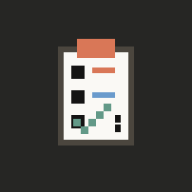
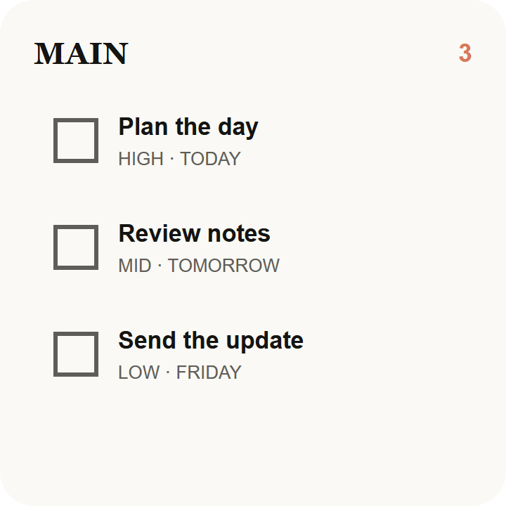
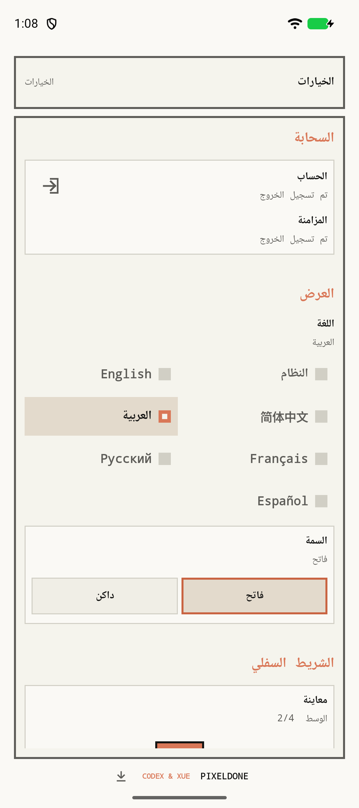
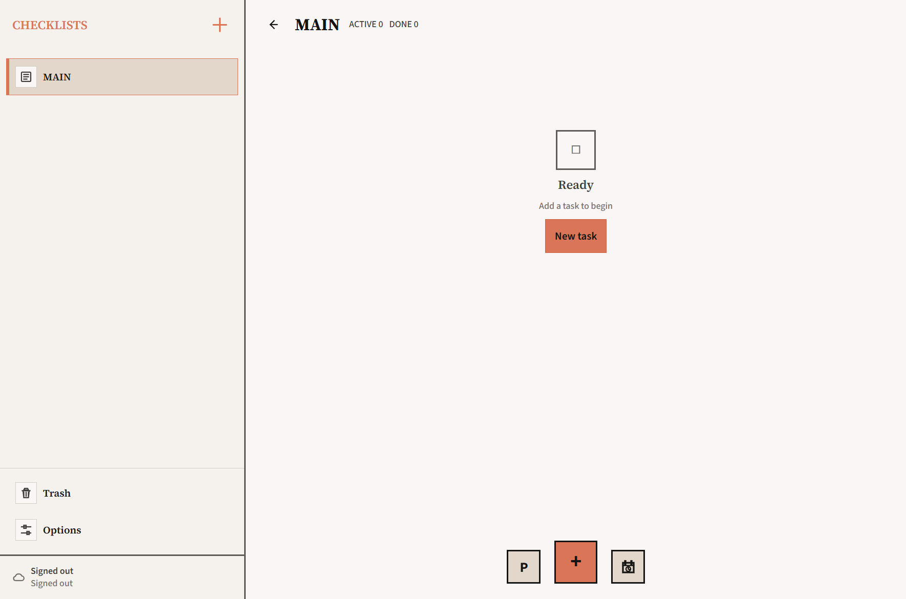
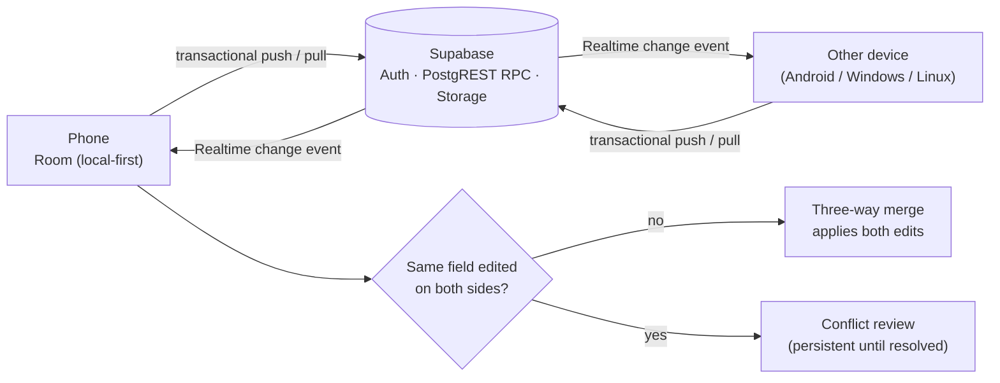

<div align="center">



# PixelDone

### A pixel-styled, offline-first todo planner for Android, with optional real-time cloud sync

<b>English</b> · <a href="./README.zh-CN.md">简体中文</a>

[](https://github.com/Siyuan-Xue/PixelDone/releases/latest)
[](https://github.com/Siyuan-Xue/PixelDone/actions/workflows/ci.yml)


[](LICENSE)

</div>

<div align="center">



<!-- screenshot slot: docs/screenshots/android-main-list.png (main list with a few tasks, portrait PNG, about 1080 x 2400). Add as  -->
<!-- screenshot slot: docs/screenshots/android-task-editor.png (bottom task editor open, portrait PNG, about 1080 x 2400). Add as  -->

</div>

## ✨ Highlights

- 📋 **Checklists that stay out of your way**: multiple lists, four priority levels (Low / Mid / High / XHigh), deadlines, sort by priority or time, and a DDL countdown view.
- ⏰ **Reminders you can trust**: exact alarms when authorized with a Doze-capable fallback, daily or weekly repeats, recovery of missed repeats, and a full-screen alarm for XHigh tasks.
- 📴 **Local-first**: everything works offline on Room. Deleted tasks sit in Trash for 30 days before they are scrubbed.
- 🔄 **Real-time sync across devices**: optional Supabase sign-in, transactional sync, Realtime updates, three-way field merge, and a conflict review that never loses data silently.
- 🧩 **Home-screen widget and custom dock**: check tasks off from the home screen, and choose up to four quick actions around the `+` button.
- 🌍 **Seven languages**: System plus the six UN languages, including full right-to-left Arabic, with light and dark themes.
- 🔐 **Verified in-app updates**: GitHub Releases first, Gitee mirror second, with SHA-256 and signing-certificate checks before install.

<details>
<summary><b>Full feature list</b></summary>

**Tasks and checklists**

- Add todos with a name, four-step priority (Low, Mid, High, XHigh) and date/time; priority colors are Low green, Mid blue, High yellow, XHigh red.
- Keep multiple local checklists, starting from a default `MAIN` list; fixed `TRASH` and `SETTINGS` lists.
- Expand the top bar to switch checklists and edit checklist names; system Back returns through this session's checklist history.
- Long-press `+` to create a new checklist; short press creates a task.
- Tap a row to edit it in the bottom editor; delete from the editor.
- Sort by priority (XHigh → Low, then due time) or by time; switch the subtitle to a DDL countdown (days, hours, minutes).
- Overdue dates are highlighted in red; a todo due exactly now counts as overdue.
- Tap the checkbox to complete or reactivate; sorting is delayed briefly so quick consecutive checks don't make the list jump.
- New, edited, reactivated or image-updated todos are revealed and briefly highlighted. Completed todos can be hidden.

**Trash**

- Deleted tasks, cleaned completed batches and tasks from deleted lists move to `TRASH`.
- Restore keeps the completed state and recreates the original list if needed.
- Recoverable items are kept for exactly 30 days, then scrubbed into a minimal tombstone so the deletion can still sync.

**Reminders**

- One local alarm notification per active todo; exact alarms when authorized, otherwise a Doze-capable inexact fallback.
- Per-todo repeat: none, daily or weekly. Only the latest missed occurrence is recovered; the next DDL advances only after delivery succeeds, then syncs.
- XHigh alarms: full-screen controls over the lock screen (without weakening it), responsive STOP/SNOOZE, Back = 10-minute snooze, a 10-minute hard timeout, and safe downgrade when permissions are missing.

**Images**

- Attach, preview, replace or remove one JPEG/PNG/WebP image (≤ 10 MiB) per todo via the system picker, with no broad photo-library permission.
- Large camera images are decoded safely for previews; the original file is preserved and synced through private Supabase Storage.

**Cloud sync**

- Sign up, sign in, sign out, change password (current-password check, then global session revocation), and manual sync from the Settings `CLOUD` area.
- Event-driven, debounced one-time WorkManager sync; no periodic sync job. Sync metadata lives in a separate, rebuildable Room database.

**Dock, settings and updates**

- Dock: `+` placement, live preview, up to four functions (`SORT`, `DDL`, `HIDE DONE`, `CLEAN DONE`, `QUICK DELETE`) and their order. Default: `SORT`, `+`, `DDL`.
- Settings: language, light/dark mode, dock, cloud sync with pending/conflict counts, update prompts, permissions and version.
- Updates: quiet check on every start; downloads only the latest channel-matching APK, shows verification progress, and installs through PackageInstaller sessions.

</details>

## 📱 Screenshots

| Home-screen widget | Settings (Arabic, RTL) | Windows client |
|:---:|:---:|:---:|
|  |  |  |

<!-- screenshot slot: docs/screenshots/android-main-light.png and docs/screenshots/android-main-dark.png (same list in light and dark theme, portrait PNG, about 1080 x 2400, shown at width 200) -->
<!-- GIF slot: docs/media/demo.gif (add task, reminder fires, check off from the widget; about 360 px wide, 10 to 20 s, under 10 MB) -->

## 📥 Download

| Platform | Latest | Notes |
|---|---|---|
| **Android 8.0+** | [PixelDone-3.3.6-release.apk](https://github.com/Siyuan-Xue/PixelDone/releases/download/v3.3.6/PixelDone-3.3.6-release.apk) ([SHA-256](https://github.com/Siyuan-Xue/PixelDone/releases/download/v3.3.6/PixelDone-3.3.6-release.apk.sha256)) | [All releases](https://github.com/Siyuan-Xue/PixelDone/releases) · [Gitee mirror](https://gitee.com/milesxue/PixelDone/releases) |
| **Windows 11 (x64)** | [v3.3.1 installer](https://github.com/Siyuan-Xue/PixelDone-windows/releases/tag/v3.3.1) | [PixelDone-windows](https://github.com/Siyuan-Xue/PixelDone-windows): Tauri 2 + Rust + Svelte |
| **Ubuntu 26.04 (amd64), beta** | [v4.0.0-beta.1 .deb](https://github.com/Siyuan-Xue/PixelDone-Linux/releases/tag/v4.0.0-beta.1) | [PixelDone-Linux](https://github.com/Siyuan-Xue/PixelDone-Linux): Rust + GTK 4 / libadwaita |

PixelDone ships as a single signed APK and is not on Google Play, so Android will ask you to allow installs from your browser or file manager. All three clients use the same sync backend, so one account works everywhere.

## 🔄 How sync works



- Every edit is committed locally first. Sync is event-driven: a local change or a Realtime event triggers a debounced, transactional pull/push through versioned (3.2) RPCs.
- Edits to different fields merge automatically. Edits to the same field become conflicts that stay listed until you resolve them. Deletions travel as tombstones and win over stale edits.
- Images sync separately through private Storage and are downloaded only when opened, so a slow upload never blocks text changes.

<details>
<summary><b>Code map</b></summary>

- `domain/todo/`: todo, checklist, sorting and reminder rules in pure Kotlin (no Android or Compose imports).
- `data/local/`: Room database for local-first storage, plus a separate, generation-based sync metadata database.
- `data/sync/`, `domain/sync/`: Supabase Auth, 3.2 transactional RPCs, Storage attachments, Realtime, field merges, mutation UUIDs, cursors and tombstones.
- `data/image/`: private image copying, signature/hash validation, on-demand caching and preview sampling.
- `data/update/`: release checks, APK checksum/signing verification, DownloadManager and PackageInstaller.
- `reminder/`: AlarmManager, notifications, boot receiver, foreground service and the XHigh full-screen alarm.
- `ui/todo/`, `ui/theme/`: Compose screens, dock, pixel-style components and theme. `di/`: manual dependency injection.

</details>

## 🧰 Tech stack

| Layer | Technology |
|---|---|
| UI | Kotlin · Jetpack Compose · Material 3 · Glance (widget) |
| Local data | Room · DataStore · Android Keystore (session storage) |
| Background | WorkManager (one-time, event-driven) · AlarmManager · foreground service |
| Cloud | Supabase Auth · PostgREST RPC · Realtime 3.6.0 (Ktor CIO WebSockets) · Storage |
| Delivery | GitHub Actions CI and release workflow · GitHub Releases + Gitee mirror |

Package `com.milesxue.pixeldone` · minSdk 26 · target SDK 37 · current version 3.3.6 (versionCode 96).

## 🛠️ Build from source

Prerequisites: a JDK and the Android SDK.

```sh
git clone https://github.com/Siyuan-Xue/PixelDone.git
cd PixelDone
./gradlew testDebugUnitTest lintDebug assembleDebug   # Windows: .\gradlew.bat …
```

Cloud sync is optional. To enable it, add the public client config to the untracked `local.properties`, or pass it as Gradle properties or environment variables:

```properties
pixeldone.supabaseUrl=YOUR_SUPABASE_URL
pixeldone.supabasePublishableKey=YOUR_SUPABASE_PUBLISHABLE_OR_ANON_KEY
pixeldone.requireCloudConfig=true
```

Only the publishable (anon) key belongs in the client; never put service-role credentials there. Backend setup is in [`docs/pixeldone-supabase-sync-setup.md`](docs/pixeldone-supabase-sync-setup.md). Release builds need signing config in the untracked `signing/release-signing.properties`. Pushing a `vX.Y.Z` tag runs [`release-android.yml`](.github/workflows/release-android.yml), which builds and signs the APK once and publishes it to GitHub and the Gitee mirror. Contributors should read [`AGENTS.md`](AGENTS.md) and [`PROJECT_SPEC.md`](PROJECT_SPEC.md) first.

## 🗺️ Roadmap

- [x] Android 3.3.x: reliable repeating reminders, sync contract 3.2
- [x] Windows client (3.3.x) and Linux beta (4.0.0-beta.1)
- [ ] TODO(Miles): next items, only if you want them public (e.g. Play Store listing)

## 📄 License

Released under the [MIT License](LICENSE). Bundled fonts keep their own SIL Open Font License 1.1 (see Credits below).

### Credits

Designed and built by Miles Xue ("CODEX & XUE"). Bundled fonts (Source Sans 3, Source Serif 4, Noto Sans SC, Noto Serif SC, Noto Sans Arabic, Noto Naskh Arabic) are distributed under the SIL Open Font License 1.1; see [`FONT_ATTRIBUTIONS.md`](FONT_ATTRIBUTIONS.md) and [`licenses/fonts/OFL-1.1.txt`](licenses/fonts/OFL-1.1.txt).
