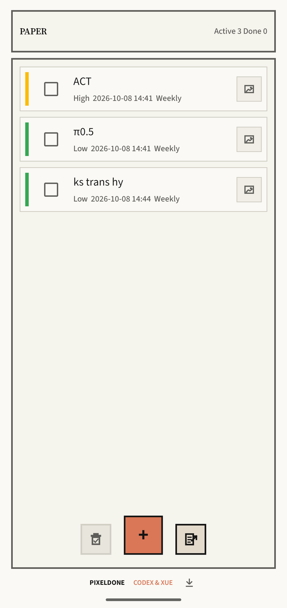
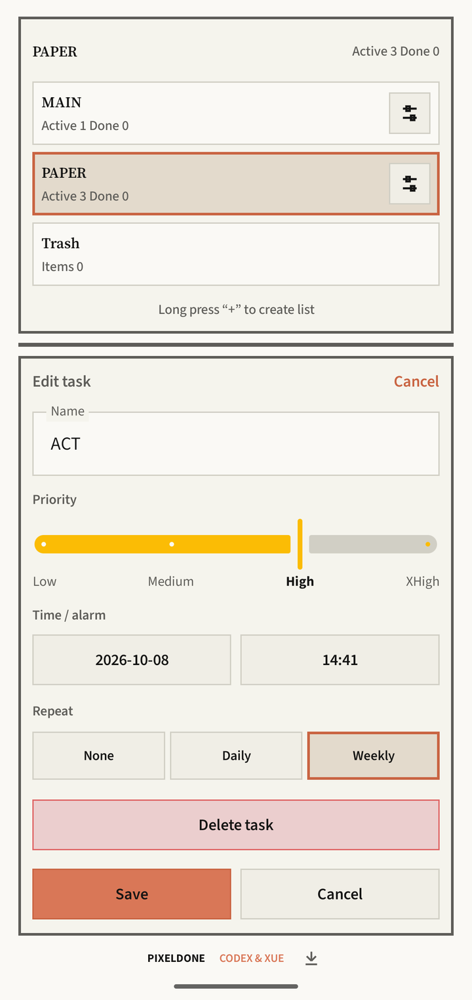
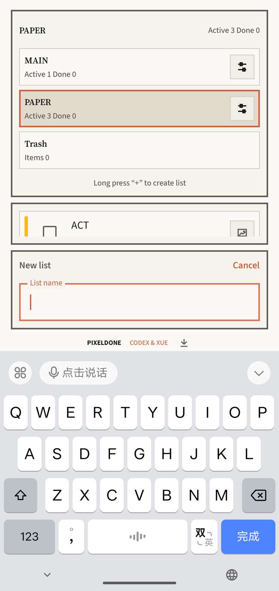
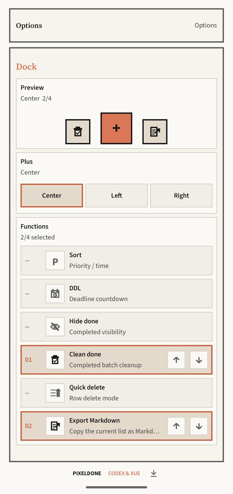
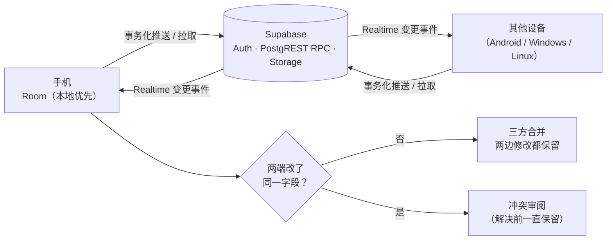

<!-- 术语表（修改中文版前请先对照）：todo/task=待办；checklist=清单；priority=优先级（Low/Medium/High/XHigh 保持英文）；DDL=截止时间（DDL）；reminder=提醒；Trash=回收站；widget=桌面小组件；dock=底部 Dock；local-first=本地优先；sync=同步；Realtime 保持英文；three-way merge=三方合并；conflict review=冲突审阅；tombstone=删除标记（tombstone）；release=发布版；APK、Supabase、Room、WorkManager、Jetpack Compose 等名称不翻译。人称统一用“你”，引号统一用「」。 -->

<div align="center">


# PixelDone

### 像素风格的 Android 待办清单：离线可用，登录后多端实时同步

<a href="./README.md">English</a> · <b>简体中文</b>

[](https://github.com/Siyuan-Xue/PixelDone/releases/latest)
[](https://github.com/Siyuan-Xue/PixelDone/actions/workflows/ci.yml)


[](LICENSE)

</div>

> 本文档与英文版同步更新；如有出入，以 [English](./README.md) 版本为准。

<div align="center">






</div>

## ✨ 亮点

- 📋 **待办一目了然**：每条待办都有优先级色条（Low 绿、Medium 蓝、High 黄、XHigh 红），并显示日期时间和重复规则；可按优先级或时间排序，也能切换成 DDL 倒计时。
- ✏️ **编辑顺手**：填好名称，拖动四档优先级滑块（Low / Medium / High / XHigh），设好闹钟日期和时间，再选择不重复、每日或每周重复。
- 🗂️ **多清单与回收站**：在顶栏切换清单，长按 `+` 新建清单；删除的任务在回收站保留 30 天。
- ⏰ **提醒可靠**：获得授权时使用精确闹钟，否则回退到兼容 Doze 的方案；支持每日、每周重复，补回错过的周期，XHigh 任务还有全屏闹钟。
- 🧩 **Dock 随你定制**：`+` 可放在中间、左侧或右侧，再挑最多四个快捷功能并排好顺序：排序、DDL 倒计时、隐藏已完成、清理已完成、快速删除、导出 Markdown（把当前清单复制为 Markdown）。桌面小组件让你不打开应用也能勾选完成。
- ☁️ **云端备份与多端同步**：一切先在本地 Room 中离线可用；登录后即可把清单备份到云端，并在 Android、Windows 和 Linux 之间实时同步。字段级三方合并，冲突一律进入审阅，不会悄悄丢数据。账号、同步、修改密码、语言和主题都在设置里。
- 🌍 **七种语言**：跟随系统，或选择联合国六种官方语言（阿拉伯语完整支持从右到左布局），并支持浅色与深色主题。
- 🔐 **应用内更新有校验**：优先从 GitHub Releases 获取，Gitee 镜像兜底，安装前核对 SHA-256 和签名证书。

<details>
<summary><b>完整功能列表</b></summary>

**待办与清单**

- 新建待办时可设名称、四档优先级（Low、Medium、High、XHigh）和日期时间；优先级颜色依次为绿、蓝、黄、红。
- 支持多个本地清单，默认从 `MAIN` 开始；另有固定的 `TRASH`（回收站）和 `SETTINGS`（设置）。
- 展开顶栏即可切换清单、修改清单名；系统返回手势会沿本次会话的清单浏览记录逐级返回。
- 长按 `+` 新建清单，短按新建任务。
- 点按任意一行，在底部编辑器中修改，也可以直接删除。
- 按优先级（XHigh → Low，再按截止时间）或按时间排序；副标题可切换为 DDL 倒计时（天、时、分）。
- 已过期的日期标红；恰好到期的待办也算作过期。
- 点复选框即可完成或重新激活；连续快速勾选时排序会稍作延迟，列表不会乱跳。
- 新建、编辑、重新激活或更新图片的待办会自动滚动到可见处并短暂高亮；已完成的待办可以隐藏。

**回收站**

- 删除的任务、批量清理的已完成任务以及被删清单中的任务，都会移入 `TRASH`。
- 恢复时保留完成状态，原清单不存在时会自动重建。
- 可恢复的条目恰好保留 30 天，之后只留下最小化的删除标记（tombstone），确保删除操作仍能同步到其他设备。

**提醒**

- 每个未完成的待办对应一条本地闹钟通知；有授权时用精确闹钟，否则回退到兼容 Doze 的非精确闹钟。
- 每个待办可设为不重复、每日或每周重复；只补回最近一次错过的提醒，通知送达成功后才推进下一次 DDL 并同步。
- XHigh 闹钟：锁屏上直接显示全屏控制（不降低锁屏安全性），STOP/SNOOZE 响应及时，返回键即贪睡 10 分钟，最长响铃 10 分钟，权限不足时安全降级。

**图片**

- 每个待办可通过系统选择器附加、预览、替换或移除一张 JPEG/PNG/WebP 图片（≤ 10 MiB），无需申请完整相册权限。
- 大尺寸相机照片也能安全生成预览，原图保持不变，并通过私有 Supabase Storage 同步。

**云同步**

- 在设置的 `CLOUD` 区域注册、登录、退出、修改密码（先验证当前密码，成功后全局注销所有会话），也可手动同步。
- 同步由事件触发，经防抖后执行一次性 WorkManager 任务，不注册周期任务；同步元数据存放在独立、可重建的 Room 数据库中。

**Dock、设置与更新**

- Dock：设置 `+` 的位置并实时预览，最多选择四个功能（`SORT`、`DDL`、`HIDE DONE`、`CLEAN DONE`、`QUICK DELETE`、`EXPORT MARKDOWN`）并调整顺序，其中导出 Markdown 会把当前清单以 Markdown 格式复制到剪贴板；默认是 `SORT`、`+`、`DDL`。
- 设置：语言、浅色/深色模式、Dock、云同步（含待同步数和冲突数）、更新提示、权限和版本信息。
- 更新：每次启动静默检查；只下载与当前渠道匹配的最新 APK，显示校验进度，并通过 PackageInstaller 会话安装。

</details>

## 🧩 小组件与 Windows 客户端

| 桌面小组件 | Windows 客户端 |
|:---:|:---:|
|  |  |

## 📥 下载

| 平台 | 最新版本 | 说明 |
|---|---|---|
| **Android 8.0+** | [PixelDone-3.3.6-release.apk](https://github.com/Siyuan-Xue/PixelDone/releases/download/v3.3.6/PixelDone-3.3.6-release.apk)（[SHA-256](https://github.com/Siyuan-Xue/PixelDone/releases/download/v3.3.6/PixelDone-3.3.6-release.apk.sha256)） | [全部版本](https://github.com/Siyuan-Xue/PixelDone/releases) · [Gitee 镜像](https://gitee.com/milesxue/PixelDone/releases)（适合国内网络） |
| **Windows 11（x64）** | [v3.3.1 安装包](https://github.com/Siyuan-Xue/PixelDone-windows/releases/tag/v3.3.1) | [PixelDone-windows](https://github.com/Siyuan-Xue/PixelDone-windows)：Tauri 2 + Rust + Svelte |
| **Ubuntu 26.04（amd64），测试版** | [v4.0.0-beta.1 .deb](https://github.com/Siyuan-Xue/PixelDone-Linux/releases/tag/v4.0.0-beta.1) | [PixelDone-Linux](https://github.com/Siyuan-Xue/PixelDone-Linux)：Rust + GTK 4 / libadwaita |

PixelDone 以单个已签名 APK 发布，没有上架 Google Play，安装时 Android 会请你允许浏览器或文件管理器安装应用。三个客户端共用同一套同步后端，一个账号即可多端使用。

## 🔄 同步机制



- 每次修改都先写入本地。同步由事件驱动：本地修改或 Realtime 事件会触发一次防抖后的事务化拉取/推送，走带版本号的 3.2 RPC。
- 不同字段的修改自动合并；同一字段的修改记为冲突，在你处理之前一直保留在列表里。删除以删除标记（tombstone）的形式同步，优先于过时的编辑。
- 图片通过私有 Storage 单独同步，打开时才下载，上传再慢也不会拖住文字内容的同步。

<details>
<summary><b>代码结构</b></summary>

- `domain/todo/`：待办、清单、排序和提醒规则，纯 Kotlin 实现，不依赖 Android 或 Compose。
- `data/local/`：本地优先的 Room 数据库，以及按代际管理、可独立重建的同步元数据库。
- `data/sync/`、`domain/sync/`：Supabase Auth、3.2 事务 RPC、Storage 附件、Realtime、字段合并、变更 UUID、游标和删除标记。
- `data/image/`：私有图片复制、签名与哈希校验、按需缓存和预览采样。
- `data/update/`：版本检查、APK 校验和与签名验证、DownloadManager 和 PackageInstaller。
- `reminder/`：AlarmManager、通知、开机广播、前台服务和 XHigh 全屏闹钟。
- `ui/todo/`、`ui/theme/`：Compose 界面、Dock、像素风组件和主题；`di/`：手动依赖注入。

</details>

## 🧰 技术栈

| 层级 | 技术 |
|---|---|
| 界面 | Kotlin · Jetpack Compose · Material 3 · Glance（小组件） |
| 本地数据 | Room · DataStore · Android Keystore（会话存储） |
| 后台任务 | WorkManager（事件触发的一次性任务） · AlarmManager · 前台服务 |
| 云端 | Supabase Auth · PostgREST RPC · Realtime 3.6.0（Ktor CIO WebSockets） · Storage |
| 交付 | GitHub Actions CI 与发布流程 · GitHub Releases + Gitee 镜像 |

包名 `com.milesxue.pixeldone` · minSdk 26 · target SDK 37 · 当前版本 3.3.6（versionCode 96）。

## 🛠️ 从源码构建

准备好 JDK 和 Android SDK。

```sh
git clone https://github.com/Siyuan-Xue/PixelDone.git
cd PixelDone
./gradlew testDebugUnitTest lintDebug assembleDebug   # Windows: .\gradlew.bat …
```

云同步是可选的。如需开启，把公开的客户端配置写进不纳入 Git 的 `local.properties`，或通过 Gradle 属性、环境变量传入：

```properties
pixeldone.supabaseUrl=YOUR_SUPABASE_URL
pixeldone.supabasePublishableKey=YOUR_SUPABASE_PUBLISHABLE_OR_ANON_KEY
pixeldone.requireCloudConfig=true
```

客户端里只能放 publishable（anon）key，千万不要放 service-role 凭据。后端配置见 [`docs/pixeldone-supabase-sync-setup.md`](docs/pixeldone-supabase-sync-setup.md)。构建 release 版需要在不纳入 Git 的 `signing/release-signing.properties` 中配置签名。推送 `vX.Y.Z` 标签会触发 [`release-android.yml`](.github/workflows/release-android.yml)：只构建并签名一次，同时发布到 GitHub 和 Gitee 镜像。参与开发前请先阅读 [`AGENTS.md`](AGENTS.md) 和 [`PROJECT_SPEC.md`](PROJECT_SPEC.md)。

## 🗺️ 路线图

- [x] Android 3.3.x：周期提醒更可靠，同步协议 3.2
- [x] Windows 客户端（3.3.x）与 Linux 测试版（4.0.0-beta.1）
- [ ] TODO(Miles)：后续计划，仅在你愿意公开时填写（例如上架 Play 商店）

## 📄 许可证

以 [MIT 许可证](LICENSE) 发布。内置字体仍遵循各自的 SIL Open Font License 1.1（见下方致谢）。

### 致谢

由 Miles Xue（「CODEX & XUE」）设计和开发。内置字体（Source Sans 3、Source Serif 4、Noto Sans SC、Noto Serif SC、Noto Sans Arabic、Noto Naskh Arabic）遵循 SIL Open Font License 1.1，详见 [`FONT_ATTRIBUTIONS.md`](FONT_ATTRIBUTIONS.md) 和 [`licenses/fonts/OFL-1.1.txt`](licenses/fonts/OFL-1.1.txt)。
